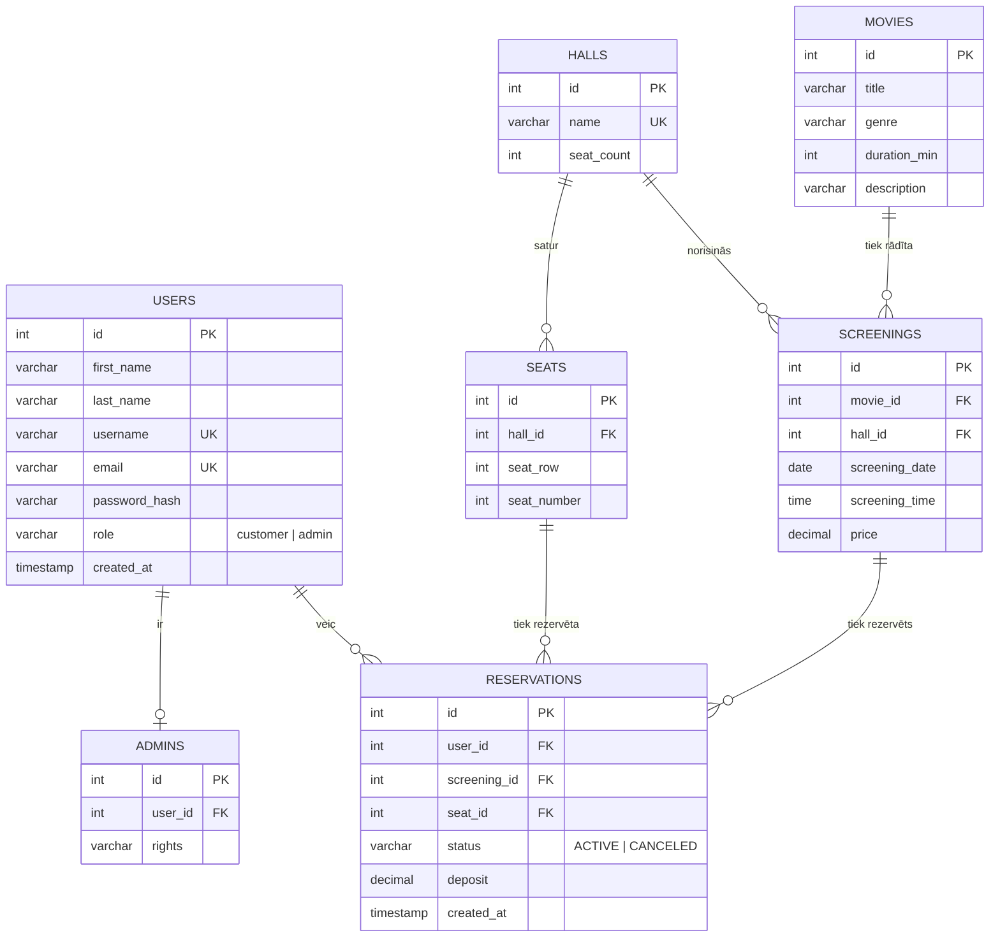

# KINO – kino biļešu rezervācijas sistēma
 
Darbvirsmas lietotne kino seansu biļešu rezervēšanai, kas izstrādāta ar **Java Swing** (NetBeans GUI Builder) un
**Apache Derby** datu bāzi. Klienti var apskatīt filmas un seansus, izvēlēties vietu zālē un rezervēt to; administrators
pārvalda filmas, seansus un rezervācijas.
 
> Projekts veidots kā **2. projekta darbs** priekšmetā *Programmas koda rakstīšana (Kodēšana)*,
> Daugavpils Tehnoloģiju un tūrisma tehnikums, grupa **PR-32**, 2026./2027. m. g.
> Projekta tēma: **7. Kino biļešu rezervācijas sistēma**.
 
## Autori
 
| Dalībnieks | GitHub |
|---|---|
| Andrejs Ivaņinoks | [@ava1anh](https://github.com/ava1anh) |
| Konstantin Dmitrijev | [@k50073544-droid](https://github.com/k50073544-droid) |
 
---
 
## Galvenās iespējas
 
**Klients**
- reģistrēšanās un ielogošanās (parole datu bāzē tiek glabāta kā SHA-256 jaucējkods);
- filmu saraksta apskate, **meklēšana pēc nosaukuma vai žanra**;
- filmas seansu apskate (tiek rādīti tikai vēl nesākušies seansi);
- **vietas izvēle zāles shēmā** (zaļa – brīva, sarkana – aizņemta, zila – izvēlēta) un vietas rezervēšana ar **1 EUR iemaksu**;
- savu rezervāciju saraksts un rezervācijas atcelšana.
**Administrators**
- filmu pārvaldība (**pievienot / labot / dzēst**);
- seansu pārvaldība (pievienot / dzēst), norādot zāli, datumu, laiku un cenu;
- visu klientu rezervāciju apskate un atcelšana jebkurā laikā.
## Biznesa noteikumi
 
| Noteikums | Vērtība |
|---|---|
| Iemaksa par rezervāciju | 1,00 EUR (netiek atgriezta) |
| Klients var atcelt rezervāciju | ne vēlāk kā **15 minūtes** pirms seansa sākuma |
| Viena vieta vienā seansā | nevar tikt rezervēta divreiz |
| Rezervēt var | tikai vēl nesākušos seansu |
| Administrators | nevar rezervēt biļetes (tikai pārvaldīt) |
| Jauna seansa pievienošana | seansam jābūt nākotnē, cenai > 0, zālē nedrīkst krustoties ar citu seansu (starp seansiem 15 min pārtraukums) |
 
**Ievades validācija:** lietotājvārds 3–30 rakstzīmes (`a-z`, cipari, `_`); parole vismaz 5 rakstzīmes; vārds un uzvārds –
tikai burti (arī latviešu); korekts e-pasta formāts; datums formātā `gggg-mm-dd`, laiks `hh:mm`, cena – skaitlis
(atļauts punkts vai komats).
 
---
 
## Izmantotās tehnoloģijas
 
| Tehnoloģija | Pielietojums |
|---|---|
| **Java 21** | programmēšanas valoda |
| **Swing + NetBeans GUI Builder** | lietotāja saskarne (1 `JFrame` + 7 `JDialog`) |
| **Apache Derby Embedded** (10.14.2.0) | relāciju datu bāze, darbs ar **JDBC** |
| **JUnit 4.13.2** | automātiskie testi |
| **NetBeans IDE** (Ant projekts) | izstrādes vide |
| **Git / GitHub** | versiju kontrole un komandas darbs |
 
Visas nepieciešamās bibliotēkas atrodas mapē [`lib/`](lib) – papildu instalācija nav vajadzīga.
 
---
 
## Palaišana
 
### Prasības
- **JDK 21** vai jaunāks;
- **NetBeans IDE** (ieteicams jaunākā versija ar Java 21 atbalstu).
### Soļi
1. Lejupielādējiet repozitoriju: **Code → Download ZIP** (un izpakojiet) vai
   `git clone <repozitorija-URL>`.
2. NetBeans izvēlnē: **File → Open Project…** un izvēlieties projekta mapi.
3. Palaidiet: **Run → Run Project (F6)**. Galvenā klase – `cinema.CinemaGUI`.
Pirmajā palaišanas reizē programma **automātiski izveido datu bāzi** mapē `database/appdb`, visas tabulas un sākuma datus.
Atsevišķi neko instalēt vai konfigurēt nav jāvajag. Datu bāzes failus var dzēst, lai sāktu no jauna.
 
### Sākuma dati
 
| Dati | Saturs |
|---|---|
| Administrators | lietotājvārds `admin`, parole `admin123` |
| Zāles | *1. zāle* (5 rindas × 8 vietas), *2. zāle* (6 rindas × 10 vietas) |
| Filmas | *Zvaigžņu ceļojums*, *Klusā nakts*, *Smieklu vakars* |
| Seansi | 4 seansi nākamajām dienām |
 
Klienta kontu var izveidot logā **Reģistrēties**.
 
> Administratora parole ir paredzēta tikai demonstrācijai – īstā lietošanā tā jānomaina.
 
---
 
## Īsa lietošanas instrukcija
 
**Klients**
1. Sākuma logā nospiediet **Reģistrēties** un aizpildiet formu, pēc tam **Ielogoties**.
2. Filmu sarakstā meklējiet filmu (**Meklēt**) vai nospiediet **Rādīt visas**.
3. Izvēlieties filmu un nospiediet **Seansi un rezervēšana**.
4. Izvēlieties seansu un nospiediet **Rezervēt vietu**.
5. Zāles shēmā izvēlieties brīvu vietu un nospiediet **Apstiprināt rezervāciju (iemaksa 1 EUR)**.
6. Logā **Rezervācijas** var apskatīt savas rezervācijas un tās atcelt (**Atcelt rezervāciju**).
7. Lai beigtu darbu, nospiediet **Atteikties** vai aizveriet programmu (tiek prasīts apstiprinājums).
**Administrators**
1. Ielogojieties ar administratora kontu.
2. Filmu logā izmantojiet **Pievienot / Labot / Dzēst** (labošana notiek atsevišķā logā *Filmas labošana*).
3. Logā **Seansi** pievienojiet seansu (zāle, datums, laiks, cena) vai izdzēsiet izvēlēto.
4. Logā **Rezervācijas** redzamas visas rezervācijas; administrators var atcelt jebkuru no tām.
---
 
## Arhitektūra
 
```
GUI (CinemaGUI)  →  service  →  dao  →  JDBC (db.DatabaseManager)  →  Apache Derby
```
 
- **GUI** – `CinemaGUI` satur galveno logu (`JFrame`) un apakšlogus (`JDialog`): ielogošanās, reģistrācija, filmu saraksts,
  filmas labošana, seansi, vietu izvēle, rezervācijas. Vienlaikus ir redzams tikai viens logs, logi tiek rādīti ekrāna
  centrā, bet pēc loga aizvēršanas ievadlauki tiek attīrīti.
- **service** – biznesa loģika un noteikumu pārbaude (`UserService`, `ReservationService`, `ScreeningService`);
  noteikumu pārkāpumi tiek paziņoti ar `BusinessException`.
- **dao** – piekļuve datiem ar `PreparedStatement` (`UserDAO`, `AdminDAO`, `MovieDAO`, `HallDAO`, `SeatDAO`,
  `ScreeningDAO`, `ReservationDAO`).
- **db** – `DatabaseManager`: savienojums ar Derby, tabulu izveide un sākuma dati.
- **model** – datu klases (`User`, `Admin`, `Movie`, `Hall`, `Seat`, `Screening`, `Reservation`, `ReservationView`).
- **util** – `Validator` (ievades validācija), `PasswordUtil` (SHA-256), `Session` (pieslēgtais lietotājs).
### Projekta struktūra
 
```
.
├── src/
│   ├── cinema/     CinemaGUI.java, CinemaGUI.form   – galvenais logs un visi dialogi
│   ├── service/    UserService, ReservationService, ScreeningService, BusinessException
│   ├── dao/        UserDAO, AdminDAO, MovieDAO, HallDAO, SeatDAO, ScreeningDAO, ReservationDAO, DaoLog
│   ├── db/         DatabaseManager
│   ├── model/      User, Admin, Movie, Hall, Seat, Screening, Reservation, ReservationView
│   └── util/       Validator, PasswordUtil, Session
├── test/           JUnit 4 testi (dao, service, util)
├── lib/            derby.jar, junit-4.13.2.jar, hamcrest-core.jar
├── nbproject/      NetBeans projekta konfigurācija
├── build.xml       Ant būvēšanas fails (NetBeans)
└── README.md
```
 
---
 
## Datu bāze
 
Datu bāze sastāv no **7 savstarpēji saistītām tabulām**. Primārās atslēgas ir automātiski ģenerētas (`IDENTITY`),
ārējās atslēgas nodrošina datu integritāti (`ON DELETE CASCADE`), bet `CHECK` ierobežojumi – korektas vērtības.
 

 
---
 
## Testēšana
 
Projektam ir **52 automātiskie JUnit 4 testi**, kas aptver datu validāciju, paroļu jaucējkodu, DAO klases un biznesa
loģiku (rezervēšana, 15 minūšu atcelšanas noteikums, seansu krustošanās, dubultrezervācijas aizliegums, ārējo atslēgu
ierobežojumi u. c.).
 
| Testu klase | Testi | Ko pārbauda |
|---|---:|---|
| `util.ValidatorTest` | 8 | ievades validācija |
| `util.PasswordUtilTest` | 4 | SHA-256 paroles jaucējkods |
| `dao.UserDAOTest` | 8 | lietotāju CRUD un meklēšana |
| `dao.MovieDAOTest` | 5 | filmu CRUD un meklēšana |
| `service.UserServiceTest` | 7 | reģistrācija un pieslēgšanās |
| `service.ScreeningServiceTest` | 6 | seansu pievienošana, krustošanās, cena |
| `service.ReservationServiceTest` | 14 | rezervēšana, atcelšana, robežgadījumi |
 
**Palaišana NetBeans:** **Run → Test Project (Alt+F6)** vai labais peles klikšķis uz testu klases → *Test File*.
 
Testi izmanto **atsevišķu testa datubāzi** (`build/test-db/appdb`), tāpēc lietotnes īstie dati mapē `database` netiek
ietekmēti.
 
---
 
## Biežākās problēmas
 
| Problēma | Risinājums |
|---|---|
| Programma neatveras un parādās *Datubāzes kļūda* | pārliecinieties, ka mape `database` nav bloķēta vai ir pieejama rakstīšanai; vienlaikus nedrīkst būt palaistas divas programmas kopijas ar vienu un to pašu datubāzi |
| Datubāze jāatjauno sākuma stāvoklī | aizveriet programmu un izdzēsiet mapi `database` – nākamajā palaišanā tā tiks izveidota no jauna |
| NetBeans neatrod bibliotēkas | pārbaudiet, ka mapē `lib` atrodas `derby.jar`, `junit-4.13.2.jar` un `hamcrest-core.jar`, un atveriet projektu caur *Open Project* |
| Nepieciešama jaunāka Derby versija | nomainiet `lib/derby.jar` pret failu no Derby izplatījuma (skat. [`lib/README.txt`](lib/README.txt)) |
 
---
 
## Dokumentācija
 
Projekta paskaidrojošais apraksts (prasību specifikācija, modeļi, ER diagramma, datu vārdnīca, UML klašu diagramma,
GUI skices, testēšanas plāns un lietotāja rokasgrāmata) tiek iesniegts atsevišķā dokumentā
(`4_PD2_PA_Ivaņinoks_Dmitrijevs_2026.docx`).
